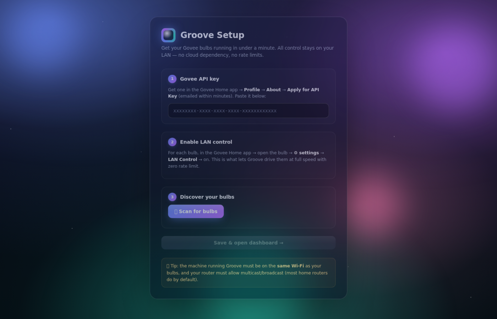

# 🎛 Groove

**Your Govee lights, actually yours.** A self-hosted controller for Govee H6008 (and other LAN-compatible) smart bulbs — no ads, no cloud lag, no 10-commands-per-minute throttle.

Groove talks to your bulbs **directly over your local network (UDP)**, so effects run instantly and free of Govee's cloud rate limit. One Flask server + a beautiful glassmorphism dashboard is all there is.

---

## ✨ Features

- **34 effects** — chase, wave, twinkle, meteor, breathe, fire, strobe, sparkle, heartbeat, lightning, police, rainbow, countdown, SOS, ocean, candy cane, jack-o'-lantern, fireworks, disco, aurora, sunset, movie, pendulum, Larson scanner, confetti, fireflies, comet, color drip, marquee, snake, thunderstorm, plasma, gradient, solid.
- **Drag-and-drop layout** — arrange bulbs on a canvas to match their real positions; effects travel along the chain.
- **Click-to-link ordering** — physically jumbled? Click bulbs in the order you want effects to run (1→2→3…), and the software does the rest.
- **Party mode** 🎉 + **Christmas party** 🎄 — auto-rotates random (or Christmas) effects and colors every ~20s. Runs on the **server**, so it keeps going even with the dashboard closed.
- **Presets** — one-tap saved setups (Christmas, Red/White/Blue, All White…).
- **Scheduler** — run any effect at a set time.
- **Dusk-to-dawn** — lights on at sunset, off at sunrise, from your ZIP code.
- **Scenes + trigger URLs** — save a color setup, recall in one tap, and get a `/trigger/<scene>` URL for Siri Shortcuts, Stream Deck, or a bookmark.
- **Add / remove / rename lights** — LAN scan or manual device-ID + IP, straight from the dashboard.
- **Live color mirroring** — the on-screen bulbs glow in their real current color, live.
- **Zero rate limit** — raw LAN UDP control bypasses Govee's cloud throttle entirely.

---

## 📸 Screenshots




---

## 🚀 Quick start

### Option A — Windows (.exe)

1. Download `Groove.exe` from the latest [GitHub release](https://github.com/Predator04/Groove/releases/latest).
2. Double-click it. A console window opens and prints `Running on http://0.0.0.0:8813`.
3. Open **http://localhost:8813/setup** in a browser.

### Option B — Docker (Synology NAS / any Linux)

```bash
docker run -d --name groove \
  --network host \
  -v /path/to/groove-data:/data \
  ghcr.io/predator04/groove:latest
```

Then open `http://<your-nas-ip>:8813/setup`.

> **`--network host` is required** — Groove discovers bulbs via UDP broadcast/multicast, which bridged Docker networks block.

### Option C — Python (any OS)

```bash
pip install -r requirements.txt
python app.py
```

---

## 🛠 Setup (under a minute)

1. Open **/setup**.
2. **API key** *(optional)* — paste your Govee API key from [developer.govee.com](https://developer.govee.com) to fetch bulb names automatically. Skip this if you'll add bulbs by IP.
3. In the Govee Home app, open each bulb → ⚙️ → **LAN Control** → on.
4. Tap **Scan** to discover bulbs on your network, or add them manually.
5. Tap **Save & open dashboard**.

> A brand-new bulb must first be joined to your home WiFi via the Govee app. The scan only finds bulbs already on the network.

---

## 🎚 Using the dashboard

| You want to… | Do this |
|---|---|
| Add a light | **➕ Add** → **🔍 Scan**, or type Device ID + IP |
| Arrange bulbs | Drag them on the canvas |
| Set effect order | **🔗 Set order** → click bulbs 1→2→3… → **Done** |
| Change the color set | Tap **+ color** to add, tap a swatch to remove |
| Run an effect | Pick from the dropdown → set **Step** speed → **Start** |
| Stop | **Stop** |
| Random show | **🎲 Surprise** (once) or **🎉 Party** (continuous) |
| Christmas show | **🎄 Christmas** (continuous, server-side) |
| Rename a bulb | Click it → type a name → Enter |
| Save a scene | **💾 Scenes** → name → **Save current** |
| Schedule an effect | **⏰ Schedule** → time → Add |
| Auto on at sunset | **⏰ Schedule** → enter ZIP → toggle **🌇 Auto** |
| Full in-app guide | **❓ Help** |

---

## 🔌 Trigger URLs (automation)

Every scene gets a public URL:

```
http://<your-host>:8813/trigger/<scene-name>
```

Use it anywhere that can hit a URL — Siri Shortcuts, Stream Deck, Home Assistant, a cron job, an NFC tag.

## 🔌 API (for other tools)

- `GET  /api/lan/devices` — list device → IP map
- `POST /api/lan/control` — `{ip, cmd:{name:"color"|"turn"|"brightness", value}}`
- `POST /api/lan/add` / `POST /api/lan/remove` / `POST /api/lan/rename` — manage lights
- `POST /api/effect/start` — `{ips, effect, colors, step_ms}`
- `POST /api/party/start` — `{theme:"christmas"|"random"}` (server-side, survives page close)
- `GET  /api/current` — live per-bulb state
- `GET  /api/scan` — LAN discovery
- `GET  /api/update` — checks GitHub for a newer version (shows an in-app banner)

---

## 🧰 Building from source

**Windows .exe** (run in PowerShell):

```powershell
pip install pyinstaller
pyinstaller --onefile --add-data "layout.html;." --add-data "setup.html;." `
  --add-data "assets;assets" --name Groove app.py
```

The `.exe` lands in `dist/Groove.exe`. Config (`config.json`, `lan_devices.json`, `names.json`, `layout.json`) is created next to the `.exe` on first run.

**Docker image**:

```bash
docker build -t groove .
```

---

## 🔌 LAN protocol (reference)

- **Discovery:** UDP multicast `239.255.255.250:4001` → devices reply on `4002`
- **Control:** UDP unicast to `device-ip:4003` (fire-and-forget):
  - `{"msg":{"cmd":"turn","data":{"value":0|1}}}`
  - `{"msg":{"cmd":"brightness","data":{"value":1-100}}}`
  - `{"msg":{"cmd":"colorwc","data":{"color":{"r","g","b"},"colorTemInKelvin":0}}}`

---

## 🐞 Troubleshooting

- **No bulbs found by scan** — the bulb isn't joined to WiFi yet (join via Govee app), or it's on a different VLAN/subnet. Add it manually by Device ID + IP.
- **A bulb doesn't respond** — it's offline or its IP changed (DHCP). Give bulbs static/reserved IPs in your router, then update them via **➕ Add**.
- **Port already in use** — set the `PORT` env var to a different port.
- **Can't reach from another device** — the server binds `0.0.0.0` by default; allow port 8813 through your OS firewall.

---

## 📜 License

MIT. Free to use, modify, and share.
