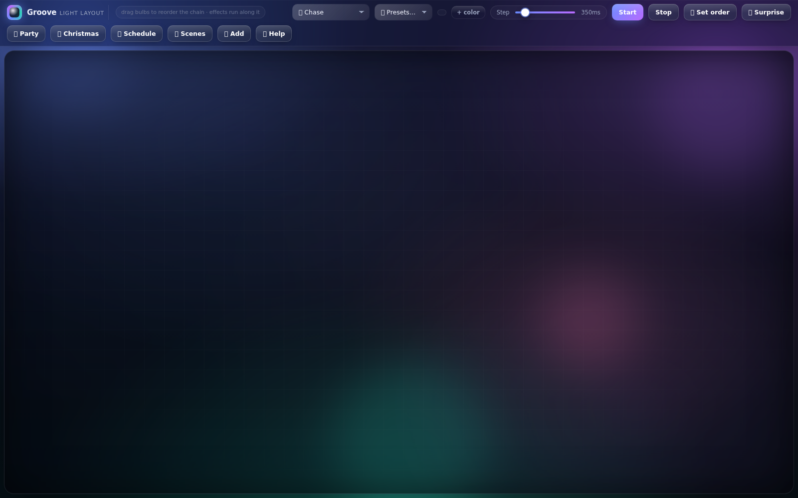

# 🎛 PrismLume

**Your Govee lights, actually yours.** A self-hosted controller for Govee H6008 (and other LAN-compatible) smart bulbs — no ads, no cloud lag, no 10-commands-per-minute throttle.

PrismLume talks to your bulbs **directly over your local network (UDP)**, so effects run instantly and free of Govee's cloud rate limit. One Flask server + a beautiful glassmorphism dashboard is all there is.

---

## ✨ Features

- **42 effects** — chase, wave, twinkle, meteor, breathe, fire, strobe, gradient, solid, sparkle, heartbeat, lightning, police, rainbow, countdown, SOS, ocean, candy cane, jack-o'-lantern, fireworks, disco, aurora, sunset, movie, pendulum, Larson scanner, confetti, fireflies, comet, color drip, marquee, snake, growing snake, thunderstorm, plasma, snowfall, icicle, fireplace, twinkling star, ornament, and two rainbow-snake variants — synchronized so they travel along your bulb chain.
- **Party modes** 🎉 — built-in 🎄 Christmas, ❄️ Snow, 🐍 Snakes, and 🎆 Show themes auto-rotate effects and colors every ~20s. **Build your own** in the full-screen Party Builder: pick effects + colors, set the travel order, preview live, and save it as a new one-tap mode. Runs on the server, so it keeps going with the dashboard closed.
- **Drag-and-drop layout** — arrange bulbs on a canvas to match their real positions; effects travel along the chain.
- **Click-to-link ordering** — physically jumbled? Click bulbs in the order you want effects to run (1→2→3…).
- **Presets** — one-tap saved setups (Christmas, Red/White/Blue, All White…).
- **Scenes + trigger URLs** — save a color setup, recall in one tap, and get a `/trigger/<scene>` URL for Siri Shortcuts, Stream Deck, or a bookmark.
- **Scheduler** — run any effect at a set time (12-hour clock).
- **Dusk-to-dawn** — lights on at sunset, off at sunrise, from your ZIP code.
- **Add / remove / rename lights** — LAN scan (with a progress bar) or manual device-ID + IP, straight from the dashboard.
- **Live color mirroring** — the on-screen bulbs glow in their real current color, live.
- **Activity log** — every effect, party, and automation action is logged and viewable in-app.
- **Auto re-discover** — quietly re-scans every 15 minutes and fixes any bulb whose IP changed (DHCP).
- **PIN protection** — optionally lock the whole app behind a PIN.
- **Backup / export / import** — download your entire setup as one JSON file and restore it anywhere.
- **Zero rate limit** — raw LAN UDP control bypasses Govee's cloud throttle entirely.

---

## 📸 Screenshots




---

## 🚀 Quick start

### Option A — Windows (.exe)

1. Download `PrismLume.exe` from the latest [GitHub release](https://github.com/Predator04/PrismLume/releases/latest).
2. Double-click it. A console window opens and prints `Running on http://0.0.0.0:8813`.
3. Open **http://localhost:8813/setup** in a browser.

### Option B — Docker (Synology NAS / any Linux)

```bash
docker run -d --name prismlume \
  --network host \
  -v /path/to/prismlume-data:/data \
  ghcr.io/predator04/prismlume:latest
```

Then open `http://<your-nas-ip>:8813/setup`.

> **`--network host` is required** — PrismLume discovers bulbs via UDP broadcast/multicast, which bridged Docker networks block.

### Option C — Python (any OS)

```bash
pip install -r requirements.txt
python app.py
```

---

## 🔑 Get your Govee API key (free, ~2 minutes)

PrismLume uses your Govee API key to pull friendly bulb names and enable cloud control. Without it you can still drive bulbs by IP, but names won't auto-populate — so grab the key first.

1. Open the **Govee Home app** on your phone.
2. Tap your **profile icon** (bottom-right) → **settings gear** (top-right).
3. Tap **"Apply for API Key"**.
4. Fill in the form — name + reason ("home automation" is fine) — and **submit**.
5. Govee emails you the key. Copy it.

📖 Official walkthrough: [Apply your Govee API key](https://developer.govee.com/reference/apply-you-govee-api-key)

## 🛠 Setup (under a minute)

1. Open **/setup**.
2. Paste your **Govee API key** (from the step above).
3. **Turn on LAN Control for each bulb** — in the Govee Home app, open the bulb → **⚙️ (top-right)** → scroll down → **LAN Control** → **enable**. ⚠️ It's **OFF by default**; PrismLume can't find or control a bulb until it's on.
4. Tap **Scan** to discover bulbs on your network, or add them manually.
5. Tap **Save & open dashboard**.

> A brand-new bulb must first be joined to your home WiFi via the Govee app. The scan only finds bulbs already on the network.

---

## 🎚 Using the dashboard

| You want to… | Do this |
|---|---|
| Add a light | **➕ Add** → **🔍 Scan**, or type Device ID + IP |
| Arrange bulbs | Drag them on the canvas |
| Set effect order | **🔗 Set order** → click bulbs 1→2→3… → **Done** |
| Paint a bulb | Pick a color on the wheel → drag the swatch onto the bulb |
| Change the color set | Tap **＋** (next to the wheel) to add the color, tap a swatch to remove |
| Run an effect | Pick from the dropdown → set **Step** speed → **Start** |
| Stop | **Stop** |
| Random show | **🎲 Surprise** (once) or **🎉 Party** (continuous) |
| Christmas show | **🎄 Christmas** (continuous, server-side) |
| Rename a bulb | Click it → type a name → Enter |
| Save a scene | **💾 Scenes** → name → **Save current** |
| Schedule an effect | **⏰ Schedule** → time → Add |
| Auto on at sunset | **⏰ Schedule** → enter ZIP → toggle **🌇 Auto** |
| Full in-app guide | **❓ Help** |

---

## 🔌 Trigger URLs (automation)

Every scene gets a public URL:

```
http://<your-host>:8813/trigger/<scene-name>
```

Use it anywhere that can hit a URL — Siri Shortcuts, Stream Deck, Home Assistant, a cron job, an NFC tag.

## 🤝 Share custom lighting

Your setups are portable — share them with anyone:

- **Whole setup** — open **🎛 Party modes → 🎨 Create mode → 📤 Export** to download your entire setup (layout, scenes, party modes, schedules, colors) as one JSON file. Send that file to someone; they import it with **📥 Import** and their bulbs match yours.
- **A single party mode** — build a light show in the Party Builder (effects + colors + travel order), tap **💾 Save**, and it becomes a one-tap theme. It's included whenever you export your setup.
- **A scene** — save a color setup as a **scene**, then share its trigger URL (`http://<host>:8813/trigger/<scene-name>`) or wire it into Siri Shortcuts / Stream Deck.
- **A picture** — the Party Builder's **📷 Share** downloads a PNG of your layout (with your room photo) to post anywhere.

## 🔌 API (for other tools)

- `GET  /api/lan/devices` — list device → IP map
- `POST /api/lan/control` — `{ip, cmd:{name:"color"|"turn"|"brightness", value}}`
- `POST /api/lan/add` / `POST /api/lan/remove` / `POST /api/lan/rename` — manage lights
- `POST /api/effect/start` — `{ips, effect, colors, step_ms}`
- `POST /api/party/start` — `{theme:"christmas"|"random"}` (server-side, survives page close)
- `GET  /api/current` — live per-bulb state
- `GET  /api/scan` — LAN discovery
- `GET  /api/update` — checks GitHub for a newer version (shows an in-app banner)

---

## 🧰 Building from source

**Windows .exe** (run in PowerShell):

```powershell
pip install pyinstaller
pyinstaller --onefile --add-data "layout.html;." --add-data "setup.html;." `
  --add-data "assets;assets" --name PrismLume app.py
```

The `.exe` lands in `dist/PrismLume.exe`. Config (`config.json`, `lan_devices.json`, `names.json`, `layout.json`) is created next to the `.exe` on first run.

**Docker image**:

```bash
docker build -t prismlume .
```

---

## 🔌 LAN protocol (reference)

- **Discovery:** UDP multicast `239.255.255.250:4001` → devices reply on `4002`
- **Control:** UDP unicast to `device-ip:4003` (fire-and-forget):
  - `{"msg":{"cmd":"turn","data":{"value":0|1}}}`
  - `{"msg":{"cmd":"brightness","data":{"value":1-100}}}`
  - `{"msg":{"cmd":"colorwc","data":{"color":{"r","g","b"},"colorTemInKelvin":0}}}`

---

## 🐞 Troubleshooting

- **No bulbs found by scan** — the bulb isn't joined to WiFi yet (join via Govee app), or it's on a different VLAN/subnet. Add it manually by Device ID + IP.
- **A bulb doesn't respond** — it's offline or its IP changed (DHCP). Give bulbs static/reserved IPs in your router, then update them via **➕ Add**.
- **Port already in use** — set the `PORT` env var to a different port.
- **Can't reach from another device** — the server binds `0.0.0.0` by default; allow port 8813 through your OS firewall.

---

## 📜 License

MIT. Free to use, modify, and share.
